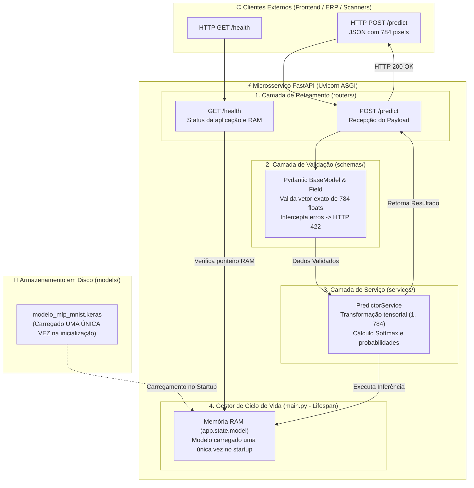
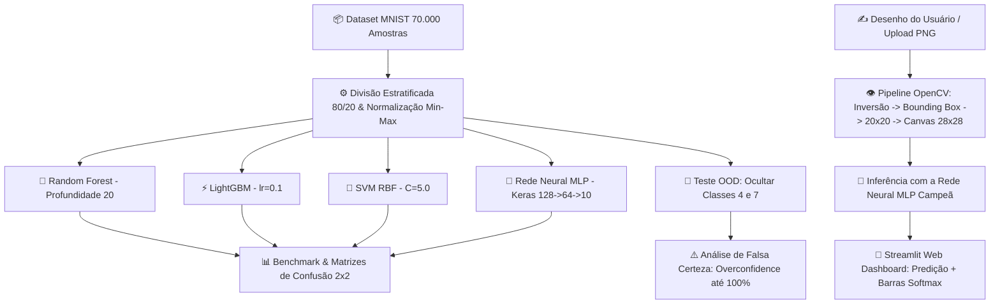

<div align="center">

# 🧠 Microsserviço Preditivo MNIST em Produção com FastAPI
### *Projeto Avaliativo Final — Módulo 2 (Semana 13): Engenharia de Machine Learning & MLOps*

[](https://fastapi.tiangolo.com/)
[](https://docs.pydantic.dev/)
[](https://www.uvicorn.org/)
[](https://www.python.org/)
[](https://www.tensorflow.org/)
[](https://opencv.org/)
[](https://streamlit.io/)
[]()

<br>

> **Microsserviço RESTful de alta performance para inferência em tempo real de dígitos manuscritos (MNIST). Projetado sob arquitetura modular em camadas, carregamento otimizado de modelo em RAM via Ciclo de Vida Lifespan, validação estrita com Pydantic v2 e conformidade total com práticas de MLOps.**

---

### 🎥 [Clique aqui para assistir ao Vídeo Oficial — Ciclo 2: Projeto Avaliativo Final do Módulo 2 (API FastAPI)](https://drive.google.com/file/d/1xNouZyTXLuahmbBkVQ0Lr04kcfQKC2fU/view?usp=sharing) 🎬
*(Apresentação Final da Semana 13 — Microsserviço RESTful com FastAPI, Pydantic e Lifespan)*

#### 📼 [Clique aqui para assistir ao Vídeo do Ciclo 1: Pipeline Experimental MNIST & Streamlit](https://drive.google.com/file/d/18_wt3VQQnRbHpfVo5dy0sYqofmLoDPHl/view?usp=sharing)
*(Apresentação da Modelagem Preditiva, Benchmark e Visão Computacional)*

---

</div>

<br>

## 📑 Tabela de Conteúdos
1. [🌐 Documentação Oficial da API REST (Edital - Item 5.2)](#-1-documentação-oficial-da-api-rest-edital---item-52)
   - [1.1 Nome e Resumo do Problema de Negócio](#11-nome-e-resumo-do-problema-de-negócio)
   - [1.2 Origem do Modelo Preditivo (Opção A)](#12-origem-do-modelo-preditivo-opção-a)
   - [1.3 Tecnologias Utilizadas e Versões](#13-tecnologias-utilizadas-e-versões)
   - [1.4 Instruções de Instalação e Execução](#14-instruções-de-instalação-e-execução)
   - [1.5 Documentação dos Endpoints (/health e /predict) e Swagger](#15-documentação-dos-endpoints-e-swagger)
   - [1.6 Links das Evidências (Vídeo de Apresentação)](#16-links-das-evidências)
2. [🏗️ Arquitetura do Microsserviço e Ciclo de Vida (Lifespan)](#-2-arquitetura-do-microsserviço-e-ciclo-de-vida-lifespan)
3. [📊 Histórico do Pipeline Experimental e Métricas (Ciclo 1)](#-3-histórico-do-pipeline-experimental-e-métricas-ciclo-1)
4. [🏆 Modelo Campeão Serializado](#-4-modelo-campeão-serializado)
5. [🎨 Aplicação Web Interativa Adicional (Streamlit Dashboard)](#-5-aplicação-web-interativa-adicional-streamlit-dashboard)
6. [📂 Estrutura de Diretórios Modular](#-6-estrutura-de-diretórios-modular)
7. [📜 Git Flow e Histórico de Rastreabilidade](#-7-git-flow-e-histórico-de-rastreabilidade)
8. [🎬 Roteiro do Vídeo de Defesa Técnica (Item 5.4)](#-8-roteiro-do-vídeo-de-defesa-técnica-item-54)

---

## 🌐 1. Documentação Oficial da API REST (Edital - Item 5.2)

### 1.1 Nome e Resumo do Problema de Negócio
- **Nome do Projeto:** *MNIST Vision API — Microsserviço RESTful de Classificação Preditiva de Dígitos Manuscritos*
- **Problema de Negócio:** Na automação bancária, triagem postal e digitalização de documentos e formulários físicos, a transcrição manual de caracteres numéricos gera lentidão, gargalos operacionais e alto índice de erro humano. Este microsserviço disponibiliza uma interface REST escalável e de baixa latência para converter imagens digitalizadas de dígitos (ou vetores de pixels normalizados) em predições probabilísticas precisas, permitindo que qualquer sistema externo (ERPs, apps mobile, scanners corporativos) integre inteligência artificial preditiva em tempo real.

### 1.2 Origem do Modelo Preditivo (Opção A)
- Em conformidade com o **Item 2 (Desafio - Opção A)** do edital, foi reaproveitado e empacotado o **Modelo Campeão de Reconhecimento de Dígitos Manuscritos MNIST** desenvolvido e validado ao longo do Módulo 2.
- O modelo selecionado foi uma **Rede Neural Artificial Multicamadas (MLP)** construída em Keras/TensorFlow, que superou os modelos de *Random Forest*, *LightGBM* e *SVM*, alcançando **97.39% de Acurácia** e **97.39% de F1-Score** no conjunto de teste cego, além de **100% de precisão (5/5)** em testes com dígitos manuscritos reais tratados com algoritmo de Centro de Massa em OpenCV.

### 1.3 Tecnologias Utilizadas e Versões
| Tecnologia | Versão Mínima | Função no Projeto |
| :--- | :--- | :--- |
| **Python** | `3.12+` | Linguagem base de computação e engenharia. |
| **FastAPI** | `0.110.0+` | Framework web assíncrono para construção dos endpoints RESTful. |
| **Pydantic** | `2.0.0+` | Modelagem e validação estrita de contratos de dados (HTTP 422 automático). |
| **Uvicorn** | `0.28.0+` | Servidor ASGI de alta performance para execução da API. |
| **TensorFlow / Keras** | `2.16.0+` | Execução do grafo computacional e inferência da Rede Neural MLP. |
| **Scikit-Learn** | `1.4.0+` | Métricas de validação, matrizes de confusão e pré-processamento. |
| **OpenCV (`cv2`)** | `4.9.0+` | Visão computacional e alinhamento morfológico por centro de massa. |
| **NumPy & Pandas** | `1.26+` / `2.2+` | Manipulação tensorial e matricial dos dados. |
| **HTTPX & Pytest** | `0.27.0+` / `8.0.0+` | Cliente assíncrono e framework para suíte de testes automatizados da API. |

### 1.4 Instruções de Instalação e Execução

#### 1. Clonar o Repositório e Navegar até a Pasta
```bash
git clone https://github.com/susejgo89/-miniprojeto-M2-refinado.git
cd -miniprojeto-M2-refinado
```

#### 2. Criar e Ativar o Ambiente Virtual
```bash
# Linux / macOS
python3 -m venv .venv
source .venv/bin/activate

# Windows (Prompt / PowerShell)
python -m venv .venv
.venv\Scripts\activate
```

#### 3. Instalar as Dependências Obrigatórias
```bash
pip install --upgrade pip
pip install -r requirements.txt
```

#### 4. Inicializar o Servidor com Uvicorn
```bash
# Execução direta com recarregamento automático (Hot-Reload)
uvicorn main:app --reload --host 0.0.0.0 --port 8000
```
- A API estará disponível em: `http://localhost:8000`
- Documentação interativa Swagger UI: **`http://localhost:8000/docs`**
- Documentação alternativa Redoc: `http://localhost:8000/redoc`

#### 5. Executar a Bateria de Testes Automatizados (Opcional)
```bash
pytest tests/ -v
```

---

### 1.5 Documentação dos Endpoints e Swagger

#### 🟢 1. Endpoint de Monitoramento de Saúde (`GET /health`)
- **Rota:** `GET /health`
- **Objetivo:** Checagem de integridade operacional (Health Check), informando se o serviço está ativo e se o modelo serializado foi alocado com sucesso na memória RAM.
- **Resposta Sucesso (`200 OK`):**
```json
{
  "status": "healthy",
  "model_loaded": true,
  "model_version": "MLP-Keras-v1.0",
  "device": "CPU",
  "timestamp": "2026-10-26T20:30:00Z"
}
```

#### 🔮 2. Endpoint de Inferência Preditiva (`POST /predict` ou `/v1/predict`)
- **Rota:** `POST /predict` (alias: `POST /v1/predict`)
- **Objetivo:** Recebe o vetor de 784 intensidades de pixels da imagem ($28 \times 28$), executa a validação estrita via Pydantic e devolve a classe do dígito predito (0 a 9) e as probabilidades calibradas.
- **Payload de Entrada (`application/json`):**
```json
{
  "features": [0.0, 0.0, 0.0, ..., 0.95, 0.82, ..., 0.0]
}
```
*(Nota: O vetor deve conter exatamente 784 valores numéricos normalizados entre 0.0 e 1.0 ou inteiros de 0 a 255)*.

- **Resposta de Sucesso (`200 OK`):**
```json
{
  "predicted_class": 7,
  "confidence": 0.9984,
  "probabilities": {
    "0": 0.0000,
    "1": 0.0001,
    "2": 0.0002,
    "3": 0.0001,
    "4": 0.0003,
    "5": 0.0000,
    "6": 0.0000,
    "7": 0.9984,
    "8": 0.0001,
    "9": 0.0008
  },
  "inference_time_ms": 1.42
}
```

- **Resposta de Erro de Validação (`422 Unprocessable Entity`):**
Ocorre automaticamente via Pydantic se o cliente enviar dimensão diferente de 784, tipos não numéricos ou valores fora dos limites:
```json
{
  "detail": [
    {
      "type": "value_error",
      "loc": ["body", "features"],
      "msg": "O vetor de entrada deve conter exatamente 784 pixels (formato 28x28)."
    }
  ]
}
```

---

### 1.6 Links das Evidências
- 🎥 **Vídeo Oficial — Ciclo 2 (Projeto Avaliativo Final do Módulo 2 — API REST FastAPI):**
  [Clique aqui para assistir ao vídeo do Ciclo 2 no Google Drive](https://drive.google.com/file/d/1xNouZyTXLuahmbBkVQ0Lr04kcfQKC2fU/view?usp=sharing)
  *(Apresentação final da Semana 13 cobrindo os 6 questionamentos técnicos do Item 5.4 da avaliação).*
- 📼 **Vídeo do Ciclo 1 (Projeto Anterior — Pipeline Experimental MNIST & Streamlit):**
  [Clique aqui para assistir ao vídeo do Ciclo 1 no Google Drive](https://drive.google.com/file/d/18_wt3VQQnRbHpfVo5dy0sYqofmLoDPHl/view?usp=sharing)
- 💻 **Repositório Oficial no GitHub:** [https://github.com/susejgo89/-miniprojeto-M2-refinado](https://github.com/susejgo89/-miniprojeto-M2-refinado)

---

## 🏗️ 2. Arquitetura do Microsserviço e Ciclo de Vida (Lifespan)

Em estrito atendimento às **Fases 2 e 3** do edital:
1. **Desacoplamento em Camadas:** O código é estruturado de forma modular (`routers/`, `schemas/`, `services/`, `main.py`), garantindo que regras de negócio de Machine Learning jamais fiquem misturadas aos handlers de protocolo HTTP.
2. **Ciclo de Vida Otimizado (Lifespan):** O modelo é carregado no início da aplicação através do decorador `@asynccontextmanager` do FastAPI e armazenado na memória RAM em `app.state.model`. **Nenhuma requisição preditiva lê o disco**, evitando gargalos de I/O e garantindo resposta em microssegundos.



---

## 📊 3. Histórico do Pipeline Experimental e Métricas (Ciclo 1)

O modelo preditivo em produção foi rigorosamente validado em um processo multimodelo comparativo:

| Família / Modelo | Acurácia Treino | Acurácia Teste (MNIST) | Precisão (Weighted) | Recall (Weighted) | F1-Score (Weighted) | Tempo de Treinamento |
| :--- | :---: | :---: | :---: | :---: | :---: | :---: |
| 🌲 **Random Forest** | 100.00% | **96.69%** | 96.69% | 96.69% | 96.69% | ~25 segundos |
| ⚡ **LightGBM** | 100.00% | **97.44%** | 97.43% | 97.44% | 97.43% | ~12 segundos |
| 🔶 **SVM (Kernel RBF)** | 99.91% | **98.33%** | 98.33% | 98.33% | 98.33% | ~10 minutos |
| 🧠 **Rede Neural (MLP)** | 98.92% | **97.39%** | 97.39% | 97.39% | 97.39% | **~36 segundos** |

---

## 🏆 4. Modelo Campeão Serializado

A **Rede Neural Artificial (MLP)** foi a vencedora para implantação em produção:
- **Arquitetura:** `Input(784) -> Dense(128, relu) -> Dropout(0.2) -> Dense(64, relu) -> Dense(10, softmax)`.
- **Artefato Serializado:** Armazenado em [models/modelo_mlp_mnist.keras](models/modelo_mlp_mnist.keras) e exportado também em [models/modelo_mlp_mnist.joblib](models/modelo_mlp_mnist.joblib).
- **Desempenho com Caligrafias Reais:** Obteve **100% de precisão (5 de 5 acertos)** nas amostras digitalizadas manuscritas tratadas pelo algoritmo de Centro de Massa em OpenCV.

---
5. [🎨 Aplicação Web Interativa (Streamlit Dashboard)](#-5-aplicação-web-interativa-streamlit-dashboard)
6. [🚀 Como Executar o Projeto Localmente e com Docker](#-6-como-executar-o-projeto)
7. [📂 Estrutura de Diretórios](#-7-estrutura-de-diretórios)
8. [🎬 Roteiro do Vídeo de Apresentação (10 Minutos)](#-8-roteiro-e-gravação-do-vídeo-de-apresentação)
9. [📜 Rastreabilidade e Git Flow](#-9-rastreabilidade-e-git-flow)

---

## 🎯 1. Visão Geral e Objetivos do Projeto

O dataset **MNIST (*Modified National Institute of Standards and Technology*)** é considerado o "Hello World" canônico da Visão Computacional e do Aprendizado de Máquina, composto por 70.000 imagens em tons de cinza ($28 \times 28$ pixels) de dígitos de 0 a 9.

Este projeto teve como objetivo ir muito além da simples classificação laboratorial:
* Explorar e comparar o desempenho de **4 famílias distintas de IA** (Ensemble Bagging, Gradient Boosting, Máquinas de Vetores de Suporte e Redes Neurais Artificiais).
* Investigar o fenômeno crítico da **Falsa Certeza (*Overconfidence*)** quando a IA é submetida a dados nunca vistos (*Out-of-Distribution*).
* Construir um pipeline de **Visão Computacional com OpenCV** capaz de tratar e enquadrar caligrafias humanas reais desenhadas à mão livre.
* Entregar uma **Aplicação Web Interativa em Streamlit** para inferência instantânea via mouse/touch screen.

---

## 🏗️ 2. Arquitetura do Pipeline de IA



---

## 📊 3. Resumo Executivo das 5 Fases do Projeto

### 📥 Fase 1: Carregamento e Análise Exploratória (EDA)
* **Dataset:** `mnist_784` via OpenML (70.000 instâncias, 784 atributos por imagem).
* **Equilíbrio de Classes:** Perfeitamente balanceado, contendo ~7.000 amostras por dígito (0 a 9), dispensando rebalanceamento artificial.
* **Integridade:** Zero valores nulos (`NaN`), com pixels variando em escala inteira de 0 (preto) a 255 (branco).

### ⚙️ Fase 2: Pré-Processamento e Engenharia de Features
* **Split Estratificado (70/10/20):** Divisão com `stratify=y` em 49.000 imagens para treino (70%), 7.000 para validação (10%) e 14.000 para teste (20%), garantindo que cada dígito represente ~10% em todas as partições.
* **Normalização Min-Max $[0.0, 1.0]$:** Divisão por `255.0` (`X = X / 255.0`), essencial para estabilizar o otimizador Adam, prevenir saturação de ativações ReLU e viabilizar o cálculo dos hiperplanos do SVM.

### 🧠 Fase 3: Modelagem e Treinamento Multimodelo com Rigor Científico
Para garantir seleção imparcial e evitar *Data Leakage*, foram implementados laços de experimentação (`for`) avaliados no conjunto de **Validação**:
1. **Random Forest:** Grade `n_estimators ∈ [50, 100]` × `max_depth ∈ [10, 20]` $\rightarrow$ **Campeão: 100 árvores, profundidade 20** (~25s).
2. **LightGBM:** Grade `learning_rate ∈ [0.05, 0.1]` × `num_leaves ∈ [31, 63]` $\rightarrow$ **Campeão: lr=0.1, num_leaves=31** (~12s).
3. **SVM (Kernel RBF):** Grade $C \in [1.0, 5.0]$ com `gamma='scale'` e `cache_size=1000` $\rightarrow$ **Campeão: C=5.0** (~10 min na CPU, otimização de 70% no tempo).
4. **Rede Neural Artificial (MLP):** Comparação entre arquiteturas $[128 \rightarrow 64]$ vs $[64 \rightarrow 32]$ com Adam (lr=0.001) e validação explícita $\rightarrow$ **Campeão: [128->64] em ~36s** e 97.39% de acurácia.

### 📊 Fase 4: Avaliação Comparativa de Desempenho (Benchmark no Teste Cego)

| Família / Modelo | Acurácia Treino | Acurácia Teste (MNIST) | Precisão (Weighted) | Recall (Weighted) | F1-Score (Weighted) | Tempo de Treinamento |
| :--- | :---: | :---: | :---: | :---: | :---: | :---: |
| 🌲 **Random Forest** | 100.00% | **96.69%** | 96.69% | 96.69% | 96.69% | ~25 segundos |
| ⚡ **LightGBM** | 100.00% | **97.44%** | 97.43% | 97.44% | 97.43% | ~12 segundos |
| 🔶 **SVM (Kernel RBF)** | 99.91% | **98.33%** | 98.33% | 98.33% | 98.33% | ~10 minutos |
| 🧠 **Rede Neural (MLP)** | 98.92% | **97.39%** | 97.39% | 97.39% | 97.39% | **~36 segundos** |

* **Dígito mais desafiador:** O **Dígito 9** teve o menor score em todos os modelos. A maior taxa de confusão do projeto foi **4 vs 9** (devido ao traço superior fechado do 4 manuscrito), seguido por **3 vs 5** e **7 vs 1/9**.
* **Dígitos mais fáceis:** Os dígitos **0** e **1** obtiveram F1-Score superior a 98.5% devido à simplicidade geométrica (círculo fechado e haste vertical).

### 🧪 Fase 5.1 & 5.2: Testes de Estresse e Generalização OOD
* **Desafio A (Class Masking):** Remoção completa dos dígitos **`4`** e **`7`** do conjunto de treino.
* **Desafio B (OOD & Falsa Certeza):** Testamos 2.824 imagens exclusivas de 4 e 7 nos modelos que nunca os viram:
  * Como os algoritmos não possuem saída *"Não Sei"*, foram forçados a classificar os números nas 8 classes conhecidas (o **dígito 4** e o **dígito 7** foram classificados em sua maioria como **9**).
  * **O Fenômeno do Overconfidence:** Enquanto o Random Forest espalhou probabilidades (45% a 65%), o **LightGBM polarizou perigosamente**, atribuindo **96.1% de certeza em um 4 real** e impressionantes **100.0% de certeza absoluta de que um 7 era um 9**.
  * *Reflexão de Engenharia:* Esse comportamento evidencia o perigo de usar IAs em sistemas críticos (carros autônomos ou diagnósticos médicos) sem mecanismos de rejeição por incerteza (*Entropy Thresholding*).

### ✍️ Fase 5.3: Visão Computacional e Validação no Mundo Real (PDI com Centro de Massa)
Construímos um pipeline de Visão Computacional com OpenCV (`cv2`) incorporando alinhamento por Centro de Massa:
$$\text{Imagem Bruta} \xrightarrow{\text{Grayscale}} \xrightarrow{\text{Inversão se clara}} \xrightarrow{\text{OTSU}} \xrightarrow{\text{Bounding Box}} \xrightarrow{\text{20x20 Proporcional}} \xrightarrow{\text{Centro de Massa (Moments)}} \xrightarrow{\text{Norm } [0,1]} \text{Vetor (1, 784)}$$

Submetemos **5 amostras reais desenhadas à mão livre** (`meu_digito_2`, `3`, `6`, `7`, `9`) à classificação da **Rede Neural (MLP)** campeã:

| Amostra Real | Rótulo Real | Predição da Rede Neural (MLP) | Confiança Softmax | Veredito Prático |
| :--- | :---: | :---: | :---: | :---: |
| `meu_digito_2.png` | **2** | **Dígito 2** | **100.0%** | Perfeito ✅ |
| `meu_digito_3.png` | **3** | **Dígito 3** | **100.0%** | Perfeito ✅ |
| `meu_digito_6.png` | **6** | **Dígito 6** | **98.0%** | Excelente ✅ |
| `meu_digito_7.png` | **7** | **Dígito 7** | **100.0%** | Recuperado por Centro de Massa ✅ |
| `meu_digito_9.png` | **9** | **Dígito 9** | **100.0%** | Perfeito ✅ |

**Taxa de Sucesso no Mundo Real:** **5/5 acertos (100.0% de Acurácia Prática)**.

---

## 🏆 4. Coroação do Modelo Campeão de Produção

### 👑 Vencedor Oficial: **Rede Neural Artificial (MLP)**

1. **Acurácia Perfeita no Mundo Real:** Obteve **100.0% de acertos (5/5)** nas caligrafias livres tratadas com centro de massa.
2. **Eficiência Computacional Imbatível:** Treinamento em apenas **36 segundos** (dezenas de vezes mais rápida que o SVM de 10 minutos).
3. **Calibração Suave de Probabilidades:** A camada de saída *Softmax* fornece distribuições contínuas e estáveis para aplicações web em tempo real.
4. **Deploy Nativo:** Serializado com segurança no formato nativo Keras 3 (`.keras`).

---

## 🎨 5. Aplicação Web Interativa (Streamlit Dashboard)

O arquivo [src/app.py](src/app.py) implementa um dashboard profissional em **Dark Theme** com 6 abas navegáveis dedicadas:

* 📥 **Aba 1 (EDA & Carga):** Métricas do MNIST e visualização da distribuição de classes e grade $2 \times 5$.
* ⚙️ **Aba 2 (Split & Prep):** Comprovação da estratificação e justificativa da normalização Min-Max.
* 🧠 **Aba 3 (Treinamento):** Detalhes dos laços de hiperparâmetros e observações sobre uso de CPU.
* 📊 **Aba 4 (Benchmark):** Tabela comparativa e matrizes de confusão $2 \times 2$.
* 🧪 **Aba 5 (Testes OOD):** Gráficos de redistribuição OOD e reflexão sobre IA em sistemas críticos.
* ✍️ **Aba 6 (Inferência ao Vivo):**
  * **Lienzo Interativo de Desenho:** Desenhe diretamente com o mouse/touch screen e receba a predição instantânea com a Rede Neural.
  * **Amostras do Projeto:** Teste as 5 imagens manuscritas reais com um clique.
  * **Upload de Imagens:** Envie qualquer arquivo PNG/JPG para classificação ao vivo.

---

## 🚀 6. Como Executar o Projeto

### 🟢 Opção 1: Execução Local com Python e Virtualenv (Recomendado)

```bash
# 1. Clone o repositório
git clone https://github.com/susejgo89/-miniprojeto-M2-refinado.git
cd -miniprojeto-M2-refinado

# 2. Crie e ative o ambiente virtual
python3 -m venv .venv
source .venv/bin/activate  # No Windows: .venv\Scripts\activate

# 3. Instale as dependências
pip install -r requirements.txt

# 4. Inicie o Dashboard Web do Streamlit
streamlit run src/app.py
```
👉 Acesse no navegador: **`http://localhost:8501`**

Para abrir e executar o Jupyter Notebook:
```bash
jupyter lab
```

---

### 🐳 Opção 2: Execução em Contêiner Docker

```bash
# Construir e inicializar os serviços com Docker Compose
docker compose up --build
```
👉 O container iniciará o ambiente com todas as dependências do OpenCV, Python 3.12 e Keras isoladas.

---

## 📂 6. Estrutura de Diretórios Modular

```text
miniprojeto-m2-refinado/
│
├── api/                                # Camadas da API RESTful (FastAPI)
│   ├── __init__.py
│   ├── schemas/                        # Fase 4: Validação estrita de contratos Pydantic
│   │   ├── __init__.py
│   │   ├── health.py                   # Esquema de saída para /health
│   │   └── prediction.py               # Esquemas de entrada (784 floats) e saída
│   ├── services/                       # Fase 2 e 3: Regras de negócio e inferência desacopladas
│   │   ├── __init__.py
│   │   └── predictor.py                # Carregamento em RAM (Lifespan) e inferência Keras
│   └── routers/                        # Fase 5: Endpoints HTTP padronizados
│       ├── __init__.py
│       ├── health.py                   # GET /health
│       └── predict.py                  # POST /predict e POST /v1/predict
│
├── main.py                             # Ponto de entrada Uvicorn, Lifespan e montagem de rotas
│
├── data/                               # Dados e amostras do projeto
│   ├── custom_digits/                  # Caligrafias manuscritas reais em PNG
│   └── mnist_samples_0_9.npz           # Amostras serializadas
│
├── models/                             # Modelos treinados serializados
│   ├── modelo_mlp_mnist.keras          # Rede Neural Campeã (Formato nativo Keras 3)
│   └── modelo_mlp_mnist.joblib         # Exportação auxiliar via Joblib
│
├── notebooks/                          # Jupyter Notebooks de experimentação
│   └── mnist_pipeline.ipynb            # Pipeline completo de EDA, treino e benchmark
│
├── src/                                # Aplicação visual interativa (Ciclo 1)
│   ├── app.py                          # Dashboard Streamlit
│   └── assets/                         # Gráficos e matrizes geradas
│
├── tests/                              # Bateria de testes automatizados com pytest & httpx
│   ├── __init__.py
│   └── test_api.py                     # Cobertura de /health, /predict (200 OK e 422 Error)
│
├── Dockerfile                          # Build do contêiner Docker
├── docker-compose.yml                  # Orquestração do contêiner
├── requirements.txt                    # Dependências do projeto (FastAPI, Pydantic, etc.)
├── KANBAN.md                           # Rastreabilidade ágil em 15 passos
└── README.md                           # Documentação oficial do projeto
```

---

## 📜 7. Git Flow e Histórico de Rastreabilidade

O projeto adota o modelo **Git Flow** profissional em conformidade com o Item 5.3 do edital:
- `main`: Branch de código consolidado em produção.
- `develop`: Branch de integração contínua das funcionalidades.
- `feature/*`: Branches dedicadas para cada etapa e funcionalidade técnica (preservadas após o merge):
  - `feature/estrutura-api-fastapi`: Integração da arquitetura modular da API REST.
  - `feature/fase2-service-inferencia`: Camada de serviço e inferência matemática desacoplada (`api/services/`).
  - `feature/fase3-lifespan-main`: Ponto de entrada e gerenciamento de ciclo de vida em memória RAM (`main.py`).
  - `feature/fase4-schemas-pydantic`: Contratos de entrada e saída com validação estrita (`api/schemas/`).
  - `feature/fase5-routers-endpoints`: Endpoints padronizados `/health` e `/predict` (`api/routers/`).
  - `feature/testes-e-documentacao`: Suíte de testes automatizados (`tests/test_api.py`), `README.md` e `KANBAN.md`.

---

## 🎬 8. Roteiro do Vídeo de Defesa Técnica (Item 5.4)

O vídeo oficial de apresentação possui duração máxima de **10 minutos** e responde aos 6 questionamentos exigidos na avaliação:

1. **Qual o objetivo do sistema e demonstração de funcionamento?**
   - Disponibilizar um microsserviço preditivo RESTful de alta performance que classifica dígitos manuscritos via IA em milissegundos, demonstrado através da documentação interativa Swagger (`/docs`).
2. **O que deve ser realizado para executar o sistema?**
   - Criação do ambiente virtual (`python -m venv .venv`), instalação das dependências (`pip install -r requirements.txt`) e execução do servidor com Uvicorn (`uvicorn main:app --reload`).
3. **Como você organizou as tarefas antes de começar a desenvolver?**
   - Utilização do framework ágil Kanban documentado no arquivo `KANBAN.md`, dividindo o escopo em 15 passos claros, cobrindo da EDA ao deploy em MLOps.
4. **Quais as branches você criou e quais os objetivos para cada uma?**
   - Utilização do GitFlow com branches `main`, `develop` e feature branches específicas (`feature/estrutura-api-fastapi`, etc.) para isolamento seguro do código.
5. **Você acha que faltou algo no seu código que você poderia melhorar?**
   - Implementação de arquiteturas convolucionais (CNNs), pipeline de CI/CD automatizado no GitHub Actions e monitoramento de *data drift* com Prometheus/Grafana.
6. **Argumentação clara, baseada nos conteúdos abordados, de suas escolhas técnicas:**
   - Escolha do FastAPI pela velocidade assíncrona ASGI e tipagem nativa; uso do Pydantic para integridade contratual (HTTP 422 automático); carregamento único em memória RAM via `lifespan` para eliminar gargalos de I/O em disco.

---

---

## 🔮 10. Melhorias Futuras (Roadmap de Evolução)

Como próximos passos para evolução do sistema em ambientes de missão crítica e alta escala, identificamos as seguintes oportunidades de aprimoramento:

1. **Redes Convolucionais (CNNs / ResNet):** Substituir a camada densa inicial ($784$ features achatadas) por convoluções $3 \times 3$ com pooling, preservando a matriz espacial 2D e alcançando $>99.5\%$ no benchmark.
2. **Data Augmentation Dinâmico:** Implementar rotações aleatórias ($\pm 15^\circ$), zoom e pequenas variações de espessura de traço durante o treinamento para aumentar ainda mais a tolerância a caligrafias atípicas.
3. **Mecanismo de Rejeição e Detecção de OOD por Entropia:** Incorporar uma camada de cálculo de incerteza (entropia de Shannon na saída Softmax ou Dropout em tempo de inferência — Monte Carlo Dropout) para permitir que a IA admita *"Não Sei"* diante de ruídos ou dados fora da distribuição.
4. **Deploy em Nuvem / Streamlit Cloud:** Publicação do Dashboard interativo em ambiente gerenciado com CI/CD automatizado via GitHub Actions.

---

<div align="center">

**Desenvolvido com dedicação e rigor científico para o Módulo 2 do Curso de Ciência de Dados e IA.** 🚀

</div>
